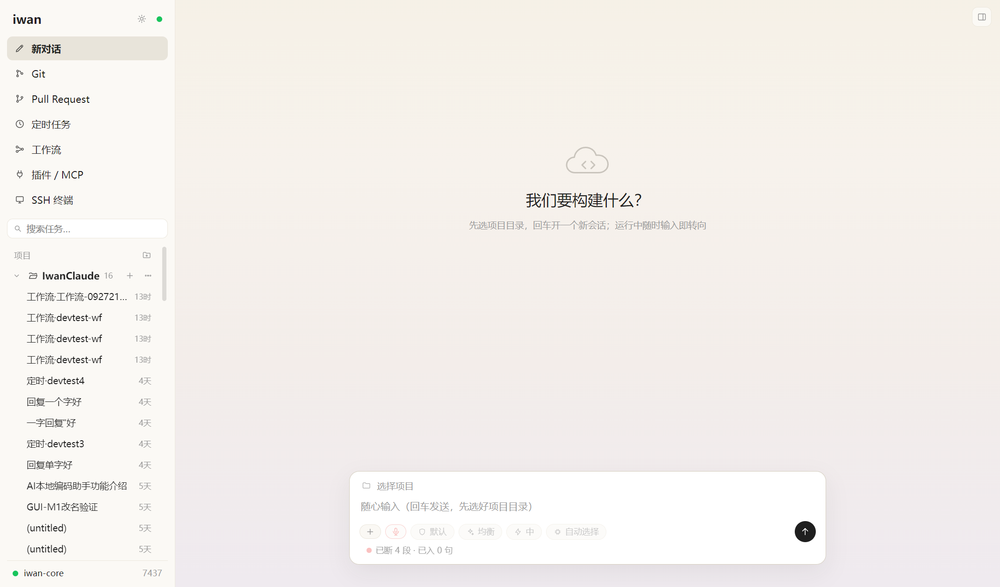
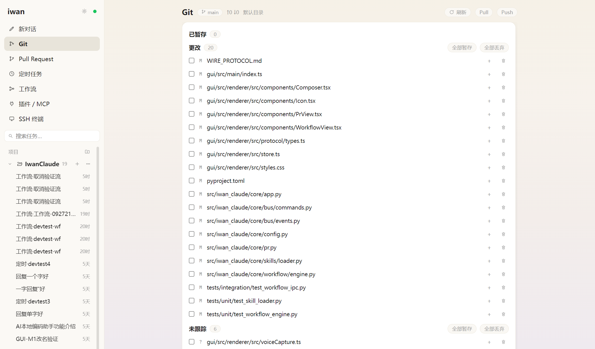
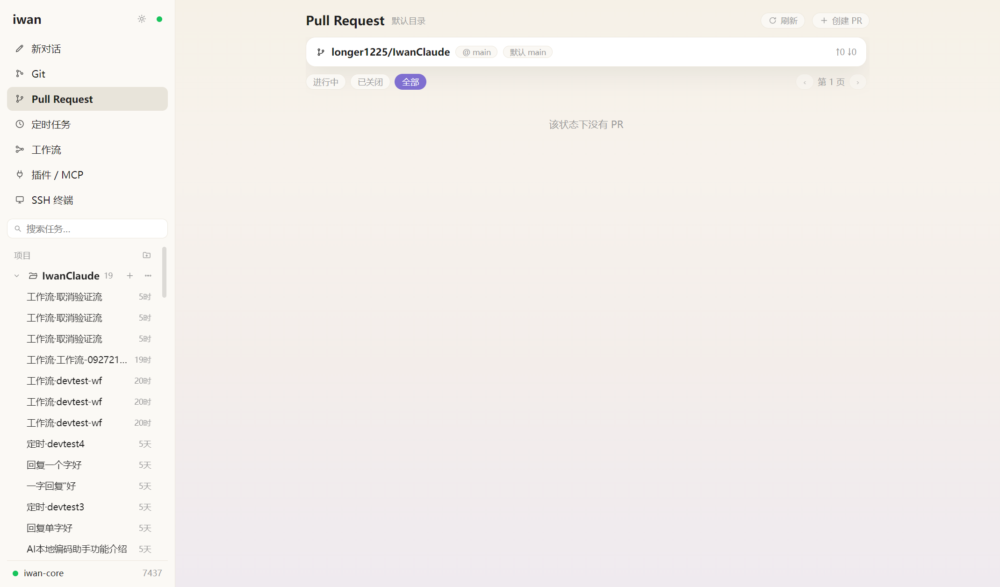
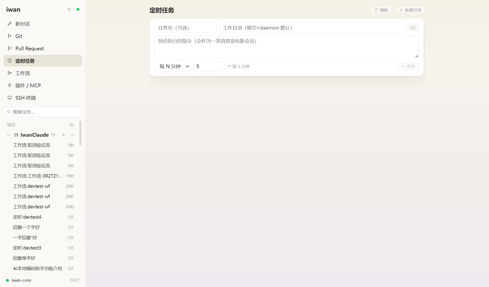
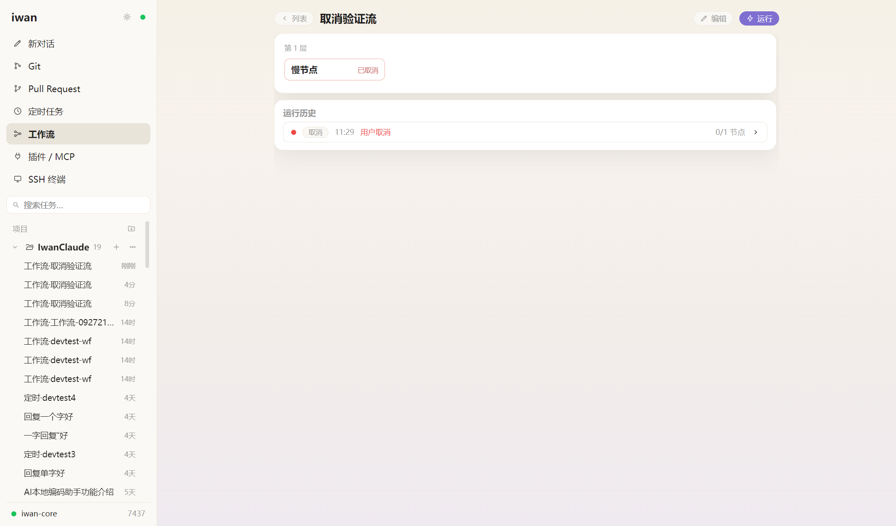
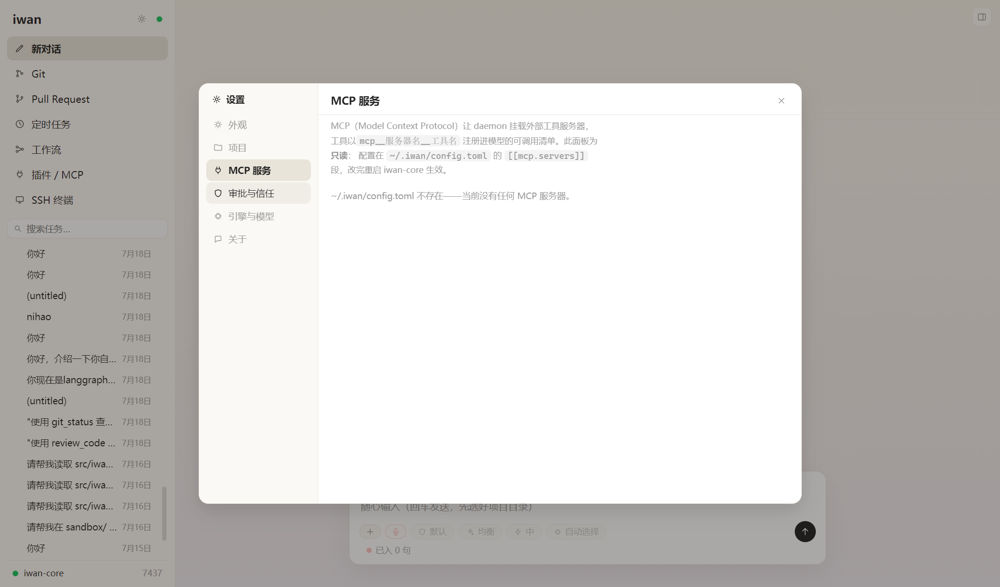
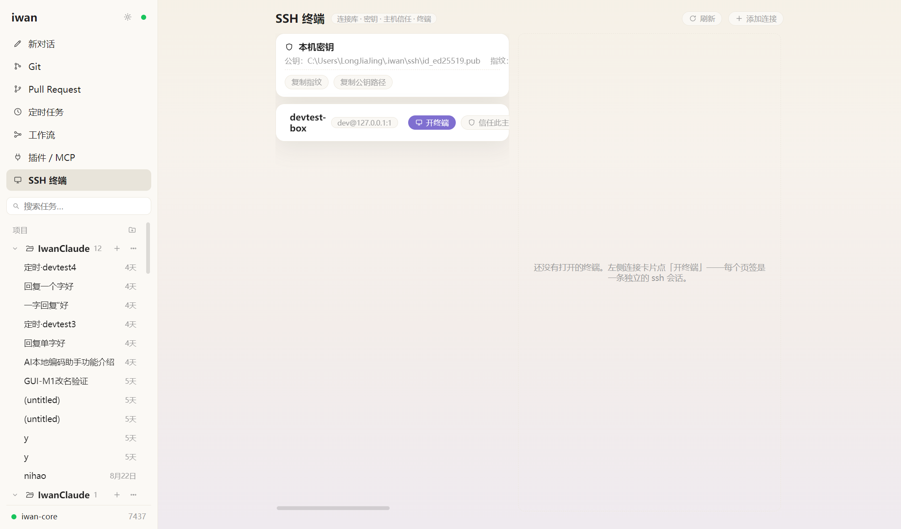
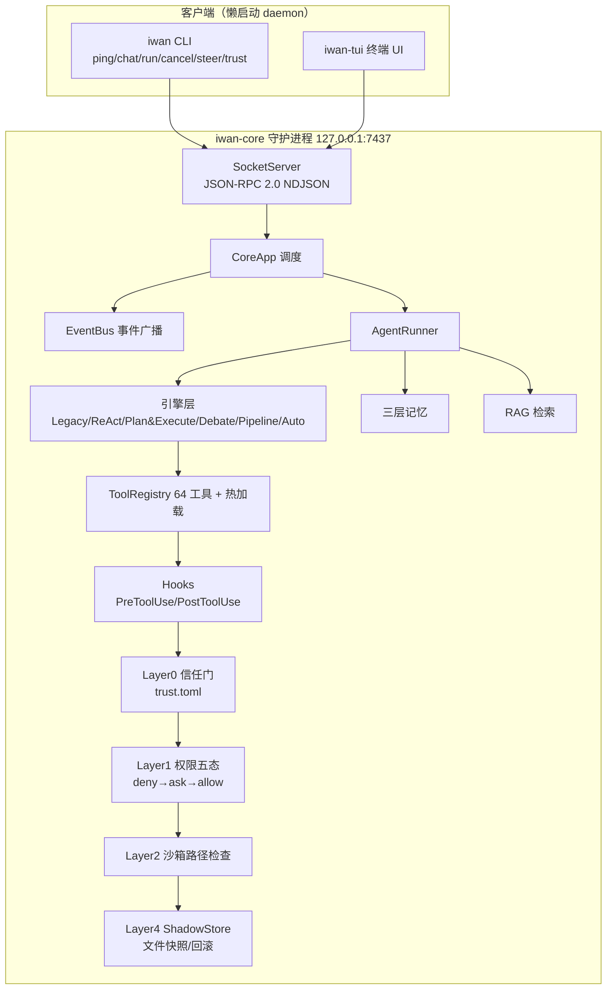

# IwanClaude


**Windows 优先的本地 AI Agent 系统** —— 6 种可切换执行引擎、五层安全防御、文件级回滚、三层记忆、RAG 检索、多智能体并行，全部跑在你自己的机器上。

`iwan-core` 是常驻守护进程（JSON-RPC 2.0 over TCP loopback），`iwan`（CLI）与 `iwan-tui`（终端 UI）是它的两个客户端。守护进程**懒启动**：任意客户端命令发现 core 未运行时会自动拉起，无需手动 `core start`。

> **平台声明**：本项目以 **Windows 原生环境为主要开发与目标平台**（Job Object 进程树管控、路径规范化、PowerShell 命令均为 Windows 优先设计）；macOS / Linux 可运行但非首发验证目标。

---

## ✨ 特性矩阵

| 模块 | 能力 |
|------|------|
| **Agent 引擎** | 6 模式可切换：Legacy / ReAct / Plan&Execute / Debate / Pipeline / **Auto**（按任务自动路由），TUI 运行时 `/engine` 动态切换 |
| **五层安全防御** | Layer0 项目信任门 → Layer1 权限系统（deny→ask→allow + 五态模式）→ Layer2 沙箱路径检查 → Layer4 审计 + 文件快照回滚（Layer3 OS 级强制已设计、暂缓） |
| **Hooks 体系** | PreToolUse/PostToolUse 钩子，exit 2 强制阻断，任何权限模式（含 bypassPermissions）跳不过 |
| **文件回滚** | ShadowStore 内容寻址快照：F7 面板勾选还原 / `/files` 命令 / CLI 三入口，还原本身也可再撤销 |
| **运行控制** | `run.cancel` 取消运行中任务 + `run.steer` 运行中追加修正指令，不用等跑完 |
| **三层记忆** | 长期记忆(JSONL) + 向量记忆(embedding) + 统一检索 Manager，AGENTS.md/CLAUDE.md 指令加载 |
| **RAG** | 6 种分块策略 + 语义/关键词混合检索 + 增量索引 + 查询重写 + 自适应策略 |
| **双进程 IPC** | JSON-RPC 2.0 NDJSON over TCP，pydantic 判别式模型定义协议，文档由代码生成 |
| **子 Agent** | 并行 Spawn + 信号量限流 + Windows Job Object 进程树击杀 |
| **TUI** | 多会话 Tab + Token 级流式 + 内联权限审批 + 信任对话框 + 检查点(F6) + 文件变更面板(F7) + 命令面板(Ctrl+P) |
| **工具系统** | 64 个内置工具 + 热加载（放 `.py` 进 `.iwan/tools/` 即发现，运行时 reload）+ 并行调用 |
| **MCP** | 外部工具服务器协议（stdio / tcp） |
| **Skills** | 项目级 > 用户级 > 内置三级技能加载，自动触发 + 手动 `/skill_name` |
| **桌面 GUI** | Electron 客户端（`gui/`）：七功能面板 + 语音输入（本地 whisper 断句）+ 权限三档预设（谨慎/顺滑/全自动） |

---

## 🖼️ 界面速览

Electron 桌面客户端（开发中，`gui/` 子工程）——连接同一个 `iwan-core` daemon，TUI 之外的图形面。

| 界面 | 说明 |
|---|---|
|  | **主界面**：会话侧栏 + 输入框，🎤 按钮本地语音输入、实时显示断句进度 |
|  | **Git**：暂存/丢弃/提交/Push/Pull 全按钮化，改动列表实时刷新 |
|  | **Pull Request**：本地坐标卡 + GitHub PR 列表 + 一键评审（此仓库尚无 PR，显示空态） |
|  | **定时任务**：到点自动起会话执行指令，新建表单即截图所示 |
|  | **工作流**：DAG 分层编排多 Agent 节点，运行历史与取消状态一目了然 |
|  | **MCP 服务**：设置面板只读展示外部工具服务器挂载情况 |
|  | **SSH 终端**：连接库 + 本机密钥 + 主机信任 + 多页签终端 |

---

## 📁 目录结构（顶层只有这些）

| 路径 | 用途 |
|---|---|
| `src/iwan_claude/` | 源码：`core/`（daemon）、`tui/`、`cli/` |
| `gui/` | Electron + React 桌面端（main / preload / renderer） |
| `tests/` | 单测（`unit/`）与集成测试（`integration/`） |
| `scripts/` | 生成器与开发脚本；手工排查脚本在 `scripts/dev/` |
| `docs/` `examples/` `samples/` `plugins/` | 设计文档、示例、样例数据、插件 |
| `项目学习图/` | 需求/设计图集（25 张 mermaid，随代码同步） |
| `runs/` | **所有本地产物**：日志、测试临时目录 `runs/tmp/`、pytest basetemp、归档；已 gitignore |

约定（避免仓库根被临时目录淹没）：

- 测试里**不要**直接 `tempfile.mkdtemp()`——统一走 `tests/tmp_utils.py::test_tmp_root()`，
  目录落在 `runs/tmp/`，夹具用 finalizer 清理（失败路径也不漏）。
- 受限环境（沙箱 / Windows 服务账号）里系统临时目录不可写时，`tempfile` 会回退到
  **当前目录**——这就是过去仓库根出现近百个 `iwan_daemon_*` 的原因。
- daemon 写家目录的三处（trace / 记忆 / 会话）都可用环境变量改道：
  `IWAN_TRACE_FILE`、`IWAN_MEMORY_DIR`、`IWAN_SESSIONS_DIR`，测试与 CI 因此不碰用户数据。

## 🏗️ 架构



---

## 🔒 安全模型（对标 Claude Code）

防御链分层，**先匹配先赢，宽 deny 永不可被窄 allow 例外**：

| 层 | 机制 | 要点 |
|---|------|------|
| **Layer 0** | 项目信任门 | 首次进入目录问一次"允许 iwan 在这里工作吗"，持久化到 `~/.iwan/trust.toml`，可撤销；deny 目录连 bypassPermissions 都绕不过写/执行工具 |
| **Layer 1** | 权限系统 | 规则序 deny → ask → allow；五态模式（default / acceptEdits / plan / auto / bypassPermissions）只放宽默认档，不穿透 deny 地板与强制 ask |
| **Hooks** | 强制前置闸 | PreToolUse 在任何权限评估前触发，exit 2 = 硬阻断并把 stderr 回灌给模型；**用户不可见层，bypass 也跳不过** |
| **Layer 2** | 沙箱路径检查 | resolve 判界 + symlink 防逃逸 + bash 命令路径扫描 |
| **Layer 4** | 审计 + 快照 | 全工具审计日志；写文件前自动快照，改坏了 F7 一键还原 |
| Layer 3 | OS 级强制 | RestrictedToken + NTFS DACL 设计已定稿（见 S9 计划书），评估后暂缓——与 Claude Code 官方 Windows 现状一致 |

default-ask 原则：未匹配任何规则的敏感操作默认弹问，而非默认放行。

---

## 🤖 Agent 引擎

5 种执行引擎 + 1 种自动路由，共享同一套工具/权限/记忆基础设施：

| 引擎 | 模式 | 工作流 | 适用场景 |
|------|------|--------|----------|
| `legacy` | 简单循环 | chat → tools → chat ... | 快速任务 |
| `langgraph` | ReAct | 边想边做 + 反思 | 探索性任务 |
| `plan_execute` | Plan & Execute | plan → execute → reflect | 复杂多步骤 |
| `debate` | Worker-Critic | worker 回答 → critic 评判 → 改进 | 质量敏感任务 |
| `pipeline` | Planner-Executor-Reviewer | plan → execute → review → 返工 | 多角色分工交付 |
| `auto` | 自动路由 | 按任务特征选择上述引擎 | 不想操心选引擎时 |

**Debate** 对标学术界 Multi-Agent Debate / LLM-as-a-Judge：worker 与 critic 双智能体，最多 3 轮，动态退出。**Pipeline** 强调职责分离：规划、执行、审查由不同 prompt 的角色承担，Reviewer 裁决 approved/needs_rework。

---

## 🚀 快速开始

> 📌 **第一次配环境、要填自己的 API Key？** 直接看 **[TEAM_SETUP.md](TEAM_SETUP.md)**（三种配 Key 方式 + 报错对照表 + 验证步骤）。
> 仓库**不内置任何 Key**：`copy .env.example .env` 后填入你自己的 Key（模板已含 DeepSeek 端点配置），或改用系统环境变量——详见下方「配置 API Key」。

### 环境要求

| 依赖 | 版本 | 说明 |
|------|------|------|
| 操作系统 | **Windows 10/11**（主要目标） | macOS / Linux 可运行，非首发验证 |
| Python | 3.12.x | 由 uv 自动管理，无需手动安装 |
| [uv](https://docs.astral.sh/uv/) | ≥ 0.4 | |

```powershell
# Windows PowerShell 安装 uv
powershell -ExecutionPolicy ByPass -c "irm https://astral.sh/uv/install.ps1 | iex"
```

### 安装与启动

```powershell
cd <放这份代码的目录>
uv sync
# 按 TEAM_SETUP.md 第 4 节写好 .env（填入你自己的 API Key）

uv run iwan-tui             # 启动 TUI（daemon 懒启动，自动拉起）
```

守护进程也可显式管理：`uv run iwan core start` / `core status` / `core stop`。

### 常用操作

```powershell
uv run iwan ping            # 验证连通：返回 pong
uv run iwan chat            # CLI 多轮对话（调试用；产品界面是 TUI）
uv run iwan trust list      # 查看项目信任条目
```

TUI 内：

```text
/engine pipeline        # 运行时切换引擎（下次对话生效）
/effort high            # 努力等级：影响推理深度与工具预算
/model powerful         # 模型预设：fast / balanced / powerful
Shift+Tab               # 循环五态权限模式
F6                      # 检查点列表/恢复（对话回溯）
F7                      # 文件变更面板（勾选 → r 还原 / f 强制还原）
/files                  # 同 F7，斜杠命令入口
Ctrl+P                  # Textual 命令面板
```

---

## 🔑 配置 API Key

**本仓库不内置任何 Key**，任何拿到它的人都必须自己配一个。三种放法任选其一：

| 放置位置 | 形态 | 作用范围 | 优先级 |
|---|---|---|---|
| GUI「设置 → 模型与 API」→ `~/.iwan/secrets.env` | 明文（仅本机用户可读） | 本机所有项目 | **最高** |
| Windows 环境变量 | 不落盘 | 按作用域而定 | 中 |
| 项目根 `.env` | 明文（已被 `.gitignore` 忽略） | 仅本项目 | 低 |

> 混用会让排查变难，**建议只用一种**。

### 方式一：Windows 用户级环境变量（推荐）

```powershell
# 1) 写入当前 Windows 用户的环境变量（永久生效）
[System.Environment]::SetEnvironmentVariable("DEEPSEEK_API_KEY", "sk-你的Key", "User")

# 2) 关掉所有 PowerShell 窗口，重新打开一个新窗口（老进程读不到新变量）

# 3) 在新窗口里验证：能回显说明写进去了（末尾 4 位不要发给别人）
[System.Environment]::GetEnvironmentVariable("DEEPSEEK_API_KEY", "User")
```

作用域由第 3 个参数决定：

| 写法 | 生效范围 | 说明 |
|---|---|---|
| `"User"` | 仅当前 Windows 用户 | ✅ 推荐 |
| `"Machine"` | 本机所有用户 | 需管理员权限，共享电脑别用 |
| `$env:DEEPSEEK_API_KEY = "sk-..."` | 仅当前这个 PowerShell 窗口 | 临时调试，关窗即失效 |

删除：`[System.Environment]::SetEnvironmentVariable("DEEPSEEK_API_KEY", $null, "User")`

> 变量名必须与 `.env` 中 `IWAN_LLM_API_KEY_ENV` 的值一致（默认 `DEEPSEEK_API_KEY`）。

### 方式二：项目根 `.env`

```powershell
copy .env.example .env
```

然后二选一：

- 把 `DEEPSEEK_API_KEY=` 那一行取消注释并填上你的 Key（明文，**别把 `.env` 发给别人**）；
- 或让它保持注释，只靠方式一的环境变量提供 Key。

`.env` 与 `pyproject.toml` 同级，程序启动时会自动加载（当前目录优先，其次包根目录）。

### 方式三：GUI 里填

启动 GUI → **设置 →「模型与 API」**（顶栏菜单「配置模型与 API Key…」可直达）→ 填 Key → 保存。
它会写进 `~/.iwan/secrets.env`：本机用户级、不进任何仓库、权限尽量收到 0600。

### 校验是否生效

```powershell
uv run python -c "import os; from iwan_claude.core.config import get_config; c = get_config(); print(c.llm.provider, c.llm.base_url, c.llm.default_model, c.llm.api_key_env, bool(os.environ.get(c.llm.api_key_env)))"
```

期望输出（末尾 `True` 才是配好）：

```text
anthropic https://api.deepseek.com/anthropic deepseek-chat DEEPSEEK_API_KEY True
```

`False` = Key 没进到进程环境，启动时会报 `DEEPSEEK_API_KEY (or ANTHROPIC_API_KEY) not set`。
优先检查：终端是否重开过、`.env` 是否在仓库根、变量名是否拼错。

---

## 🧠 模型使用约定

### 1. 模型名只接受这两个

| 模型 | 特点 | 适合 |
|---|---|---|
| `deepseek-chat` | 快、便宜（默认） | 日常改代码、写功能、问答 |
| `deepseek-reasoner` | 推理强、慢、贵 | 复杂调试、架构设计、难题 |

其他名字（如 `claude-*`、`gpt-*`）发过去会被上游拒绝，通常表现为 **404 或 model not found**。

### 2. 三档预设 fast / balanced / powerful

TUI 内用 `/model fast|balanced|powerful` 切换，或用 `IWAN_MODEL_PRESET` 设默认档。每一档实际用哪个模型，按此顺序解析：

1. `config.toml` 的 `[llm.presets]` 里为该档显式指定的模型名；
2. 否则用 `IWAN_LLM_DEFAULT_MODEL`（**当前配置就停在这一层**）；
3. 两者都没有，才用内置表（`deepseek-chat` / `claude-sonnet-4-6` / `claude-opus-4-1-20250805` —— 混了两个服务商，只能算兜底）。

> ⚠️ **按当前 `.env` 配置，切三档并不会真的换模型**：三档都会落到 `deepseek-chat`，区别只在上下文窗口预算。这是"我明明切了 powerful 却没变化"的根因。

想让档位真正区分，建 `~/.iwan/config.toml`（全局）或 `.iwan/config.toml`（项目级，已被 gitignore）：

```toml
[llm]
default_model = "deepseek-chat"

[llm.presets]
fast     = "deepseek-chat"
balanced = "deepseek-chat"
powerful = "deepseek-reasoner"
```

### 3. 上下文与步数

| 变量 | 默认 | 含义 |
|---|---|---|
| `IWAN_LLM_CONTEXT_WINDOW` | `128000` | 只用于计算"上下文占用百分比"，不是给模型扩窗；填错会让界面数字失真 |
| `IWAN_MAX_STEPS` | `20` | 单次任务最多 20 个工具回合，防死循环；长任务可调大 |
| `IWAN_COMPACT_THRESHOLD` | 关闭 | 上下文占用超过该比例自动压缩历史（如 `0.9`） |

---

## 🔌 协议约定

两种协议，**`provider` 与 `base_url` 必须配套**。只改一个 = 拿 A 协议的路径去打 B 协议的端点，症状往往伪装成"Key 无效"：

| provider | base_url 填什么 | 程序实际请求 | Key 怎么带 |
|---|---|---|---|
| `anthropic`（默认） | Anthropic 兼容端点，**到 `/anthropic` 为止**<br>`https://api.deepseek.com/anthropic` | SDK 自动拼 `/v1/messages`<br>→ `.../anthropic/v1/messages` | `x-api-key` 头 |
| `openai_compatible` | OpenAI 兼容端点，**必须带 `/v1`**<br>`https://api.deepseek.com/v1` | 程序拼 `/chat/completions`<br>→ `.../v1/chat/completions` | `Authorization: Bearer` |

硬规则：

1. `IWAN_LLM_API_KEY_ENV` 只写**变量名**（`DEEPSEEK_API_KEY`），绝不写 Key 本身；
2. 换服务商时 `provider` + `base_url` + `api_key_env` **三件套一起改**；
3. `base_url` 末尾不要带 `messages`、`chat/completions`，也不要带 query，程序自己拼；
4. 配错协议的典型症状：**404**（路径不存在）、**401**（鉴权头类型不对）、或返回 HTML 而不是 JSON。

常见厂商对照：

| 服务商 | provider | base_url | api_key_env |
|---|---|---|---|
| DeepSeek（推荐） | `anthropic` | `https://api.deepseek.com/anthropic` | `DEEPSEEK_API_KEY` |
| DeepSeek（OpenAI 协议） | `openai_compatible` | `https://api.deepseek.com/v1` | `DEEPSEEK_API_KEY` |
| 通义千问 | `openai_compatible` | `https://dashscope.aliyuncs.com/compatible-mode/v1` | `DASHSCOPE_API_KEY` |
| Ollama（本地） | `openai_compatible` | `http://127.0.0.1:11434/v1` | 任意名（变量必须存在，值可随便填） |

---

## 🧪 测试与质量

```powershell
uv run python -m pytest tests/unit -q          # 990+ 单测，无需 daemon
uv run python -m pytest tests/ -q              # 全量（集成测试自动拉起临时 daemon）
uv run ruff check src tests scripts            # lint
uv run python -m mypy src                      # 类型检查
uv run python scripts/gen_protocol_doc.py --check  # 校验 WIRE_PROTOCOL.md 与模型同步
```

54+ 测试文件覆盖：引擎逻辑、工具调用、权限五态与信任地板、hooks、ShadowStore 快照/还原、RAG、会话管理、IPC 协议、沙箱路径、Job Object、子 Agent。

---

## 📚 文档

| 位置 | 内容 |
|------|------|
| **[docs/README.md](./docs/README.md)** | **文档导航（分类索引 + 复盘路线）** |
| [docs/design/](./docs/design/) | 设计思路与决策记录：hooks、权限五态、RAG、取消/修正、子 Agent |
| [docs/architecture/](./docs/architecture/) | 模块深潜：CoreApp、PermissionManager、SessionManager、沙箱 |
| [docs/plans/](./docs/plans/) | 阶段计划书与路线图（S8 已交付 / **S9 信任+回滚已交付，OS 层暂缓有记录** / S10 GUI 规划中） |
| [docs/learning/](./docs/learning/) | Claude Code 官方权限/沙箱调研存档（改安全代码前的对照事实）+ 教学材料 |
| [RUNBOOK.md](./RUNBOOK.md) | 完整操作参考：配置、开发命令、故障排查 |
| [WIRE_PROTOCOL.md](./WIRE_PROTOCOL.md) | IPC 协议定义（由 pydantic 模型生成，勿手动编辑） |
| [CLAUDE.md](./CLAUDE.md) | 工程约定：命令、架构速览、安全事实模型 |

---

## 📄 License

[MIT](./LICENSE)
